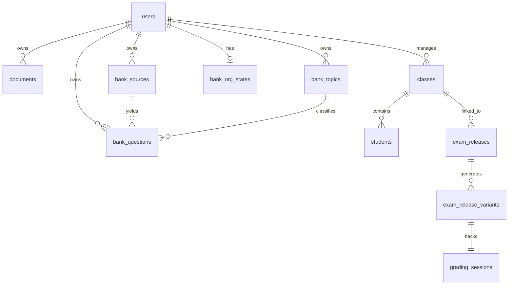

# Mô hình Dữ liệu & Kiến trúc Lưu trữ (005-commercial-readiness)

## 1. Chiến lược Di trú Cơ sở Dữ liệu (`db/migrations/0015_commercial_foundation.sql`)

Nguyên tắc bắt buộc:
- **Additive-only**: Chỉ thêm bảng/cột/index mới và nới trigger một cách có kiểm soát; **không xoá** `document_libraries` hoặc `question_banks` ngay để bảo đảm rollback an toàn.
- **Tự động Backfill Idempotent**: Ngay trong transaction của migration `0015`, giải nén toàn bộ dữ liệu đang nằm trong `document_libraries.documents` và `question_banks.state` sang các bảng chuẩn hoá mới bằng `ON CONFLICT DO NOTHING`.



---

## 2. Schema SQL Chi tiết (`0015_commercial_foundation.sql`)

### 2.1 Bảng `documents` (thay thế `document_libraries` 10MB JSONB)
```sql
create table if not exists documents (
  owner_id uuid not null references users(id) on delete cascade,
  id text not null check (length(id) between 1 and 200),
  kind text not null default 'exam' check (kind in ('exam', 'answer-key')),
  parent_id text,
  title text not null,
  subject text not null default 'toan',
  grade integer check (grade is null or (grade >= 1 and grade <= 12)),
  content text not null default '',
  structure jsonb,
  answer_key_questions jsonb,
  source_content_hash text,
  content_status text check (content_status is null or content_status in ('complete', 'preview')),
  revision bigint not null default 1,
  created_at timestamptz not null default now(),
  updated_at timestamptz not null default now(),
  primary key (owner_id, id)
);

create index if not exists documents_owner_updated_idx
  on documents (owner_id, updated_at desc);
create index if not exists documents_owner_parent_idx
  on documents (owner_id, parent_id);
```

**Backfill từ `document_libraries`**:
```sql
insert into documents (
  owner_id, id, kind, parent_id, title, subject, grade, content,
  structure, answer_key_questions, source_content_hash, content_status,
  created_at, updated_at
)
select
  dl.owner_id,
  d->>'id',
  coalesce(nullif(d->>'kind', ''), 'exam'),
  d->>'parentId',
  coalesce(d->>'title', 'Đề thi mới'),
  coalesce(d->>'subject', 'toan'),
  case
    when (d->>'grade') ~ '^\d+$' and (d->>'grade')::int between 1 and 12
    then (d->>'grade')::int
    else null
  end,
  coalesce(d->>'content', ''),
  d->'structure',
  d->'answerKeyQuestions',
  d->>'sourceContentHash',
  d->>'contentStatus',
  coalesce((d->>'createdAt')::timestamptz, now()),
  coalesce((d->>'updatedAt')::timestamptz, now())
from document_libraries dl
cross join lateral jsonb_array_elements(dl.documents) as d
where d->>'id' is not null and length(d->>'id') between 1 and 200
on conflict (owner_id, id) do nothing;
```

### 2.2 Hệ bảng Kho câu hỏi chuẩn hoá (thay thế `question_banks` 24MB JSONB)

Thay vì lưu `blocks` gồm `{ start, end, html, text }` nhân 3 lần dung lượng `raw_html`, `bank_sources` chỉ lưu `block_ranges: Array<{ start: number; end: number }>` và tái tạo `SourceBlock` bằng `raw_html.slice(start, end)` ở tầng server khi cần.

```sql
create table if not exists bank_topics (
  owner_id uuid not null references users(id) on delete cascade,
  id text not null check (length(id) between 1 and 120),
  label text not null check (length(label) between 1 and 100),
  parent_id text,
  sort_order integer not null default 0,
  is_locked boolean not null default false,
  scope_note text,
  created_at timestamptz not null default now(),
  primary key (owner_id, id)
);

create table if not exists bank_sources (
  owner_id uuid not null references users(id) on delete cascade,
  id uuid not null,
  operation_key text not null,
  payload_hash text,
  doc_id text not null,
  title text not null,
  raw_html text not null,
  hash text not null,
  block_ranges jsonb not null default '[]'::jsonb,
  status text not null check (status in ('pending', 'processing', 'review', 'complete', 'failed')),
  error text,
  candidates jsonb not null default '[]'::jsonb,
  preview_version text not null,
  confirmed_ids jsonb not null default '[]'::jsonb,
  extraction_mode text not null default 'ai' check (extraction_mode in ('native', 'ai')),
  structure jsonb,
  answer_key jsonb,
  lease_token uuid,
  lease_until bigint,
  attempts integer not null default 0,
  created_at timestamptz not null default now(),
  primary key (owner_id, id),
  unique (owner_id, operation_key)
);

create table if not exists bank_questions (
  owner_id uuid not null references users(id) on delete cascade,
  id uuid not null,
  source_id uuid not null,
  candidate_id text not null,
  label text not null,
  question_type text not null default 'mc' check (question_type in ('mc', 'tf', 'short', 'essay')),
  custom_html text,
  body_block_ids jsonb not null default '[]'::jsonb,
  context_block_ids jsonb not null default '[]'::jsonb,
  topic_id text not null default 'root',
  answer text,
  points numeric(6, 2),
  rubric_steps jsonb,
  organized boolean not null default false,
  created_at timestamptz not null default now(),
  updated_at timestamptz not null default now(),
  primary key (owner_id, id),
  foreign key (owner_id, source_id) references bank_sources(owner_id, id) on delete cascade
);

create index if not exists bank_questions_owner_topic_idx
  on bank_questions (owner_id, topic_id, created_at desc);

create table if not exists bank_org_states (
  owner_id uuid primary key references users(id) on delete cascade,
  status text not null default 'complete' check (status in ('pending', 'processing', 'complete', 'failed')),
  error text,
  lease_token uuid,
  lease_until bigint,
  attempts integer not null default 0,
  revision bigint not null default 1,
  updated_at timestamptz not null default now()
);
```

### 2.3 Mở rộng Lớp học, Bộ mã đề & Bài làm THPT 2025

1. **Lớp học & Năm học**:
```sql
alter table classes
  add column if not exists academic_year text,
  add column if not exists archived_at timestamptz;
```

2. **Liên kết `exam_releases` ↔ `classes` (bảo toàn tính bất biến đề/đáp án/phiếu)**:
```sql
alter table exam_releases
  add column if not exists class_id uuid references classes(id) on delete set null,
  add column if not exists class_name text;

alter table grading_sessions
  add column if not exists release_id uuid references exam_releases(id) on delete set null,
  add column if not exists roster_snapshot jsonb;

-- Cập nhật trigger protect_exam_release() để chỉ cho phép cập nhật class_id và class_name
create or replace function protect_exam_release() returns trigger language plpgsql as $$
begin
  if tg_table_name = 'exam_releases' and tg_op = 'UPDATE' then
    if new.id = old.id
      and new.owner_id = old.owner_id
      and new.source_exam_id = old.source_exam_id
      and new.title = old.title
      and new.source_sha256 = old.source_sha256
      and new.input::text = old.input::text
      and new.warnings::text = old.warnings::text
      and new.algorithm_version = old.algorithm_version
      and new.idempotency_key = old.idempotency_key
      and new.request_sha256 = old.request_sha256
      and new.created_at = old.created_at
    then
      return new;
    end if;
  end if;
  raise exception 'Published exam releases are immutable';
end; $$;
```
*(Tương tự giữ nguyên kiểm tra bất biến `snapshot_id, rubric_revision_id, sheet_template, owner_id` trên `protect_published_session()`, cho phép gắn `class_id, class_name, release_id, roster_snapshot` từ `exam_releases` xuống `grading_sessions` con).*

3. **Lưu đáp án học sinh cho Đúng/Sai (`tf`) & Trả lời ngắn (`short`)**:
   - Kiểm tra constraint của `mc_answers.picked` trong `0003_grading.sql`: nếu có CHECK giới hạn 1 ký tự `A–D`, nới lỏng hoặc thêm cột `answer_payload jsonb` trên `mc_answers` (và giữ `picked text` tương thích cho cả `A–D`, chuỗi `tf` kiểu `D-S-D-S` / JSON, và chuỗi `short` kiểu `-12,5`).

---

## 3. Cấu trúc Kiểu dữ liệu TypeScript Trọng tâm

### 3.1 `Rubric` v2 (`lib/grading/rubric.ts`)
```ts
export type McLetter = 'A' | 'B' | 'C' | 'D';
export type TfKey = 'a' | 'b' | 'c' | 'd';
export type TfStatements = Record<TfKey, boolean>;

export type McQuestion = {
  no: number;          // Thứ tự toàn cục duy nhất trong rubric (1..N)
  sectionNo?: number;  // Phần (1, 2, 3, 4)
  displayNo?: number;  // Số câu hiển thị trong phần (vd Phần II Câu 1)
  type: 'mc';
  points: number;
  answer: McLetter;
  label?: string;
};

export type TfQuestion = {
  no: number;
  sectionNo?: number;
  displayNo?: number;
  type: 'tf';
  points: number; // Mặc định 1.0 điểm theo chuẩn THPT 2025
  statements: TfStatements;
  scoringRule?: 'moet-2025' | 'equal'; // moet-2025: 1 ý=10%, 2 ý=25%, 3 ý=50%, 4 ý=100%
  label?: string;
};

export type ShortAnswerQuestion = {
  no: number;
  sectionNo?: number;
  displayNo?: number;
  type: 'short';
  points: number;
  acceptedAnswers: string[]; // Chuẩn hoá dấu phẩy/chấm: ["-12,5", "-12.5"]
  label?: string;
};

export type EssayQuestion = {
  no: number;
  sectionNo?: number;
  displayNo?: number;
  type: 'essay';
  points: number;
  steps: EssayStep[];
  label?: string;
  answer?: string;
};

export type RubricQuestion = McQuestion | TfQuestion | ShortAnswerQuestion | EssayQuestion;
```

### 3.2 Quy tắc tính điểm Đúng/Sai THPT 2025 (`lib/grading/scores.ts`)
- Tổng số ý khớp `matches` trong `{ a, b, c, d }` ∈ `[0..4]`.
- Nếu `scoringRule === 'moet-2025'` (mặc định):
  - `matches === 0` → `0%`
  - `matches === 1` → `10%` (`0.1` nếu `points = 1.0`)
  - `matches === 2` → `25%` (`0.25` nếu `points = 1.0`)
  - `matches === 3` → `50%` (`0.5` nếu `points = 1.0`)
  - `matches === 4` → `100%` (`1.0` nếu `points = 1.0`)
- Tính bằng số nguyên phần trăm (`toHundredths`) để không sai số dấu phẩy động.

### 3.3 `SheetTemplate` v2 (`lib/grading/sheet-template.ts`)
```ts
export type SheetTfBubble = {
  q: number;
  stmt: TfKey; // 'a' | 'b' | 'c' | 'd'
  value: 'Đ' | 'S';
  cx: number;
  cy: number;
  r: number;
};

export type SheetShortCell = {
  q: number;
  col: number;     // 0..3 (tối đa 4 ký tự)
  symbol: string;  // '-' | ',' | '0'..'9'
  cx: number;
  cy: number;
  r: number;
};
```
- Bổ sung `tfBubbles?: SheetTfBubble[]`, `shortCells?: SheetShortCell[]`, và `pageCount: 1 | 2` (tự động đẩy `essayBoxes` sang trang 2 kèm cặp 4 dấu định vị góc khi trang 1 đã chứa đủ MC + TF + Short).
